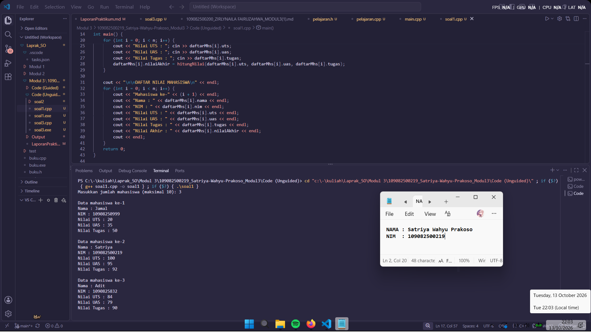
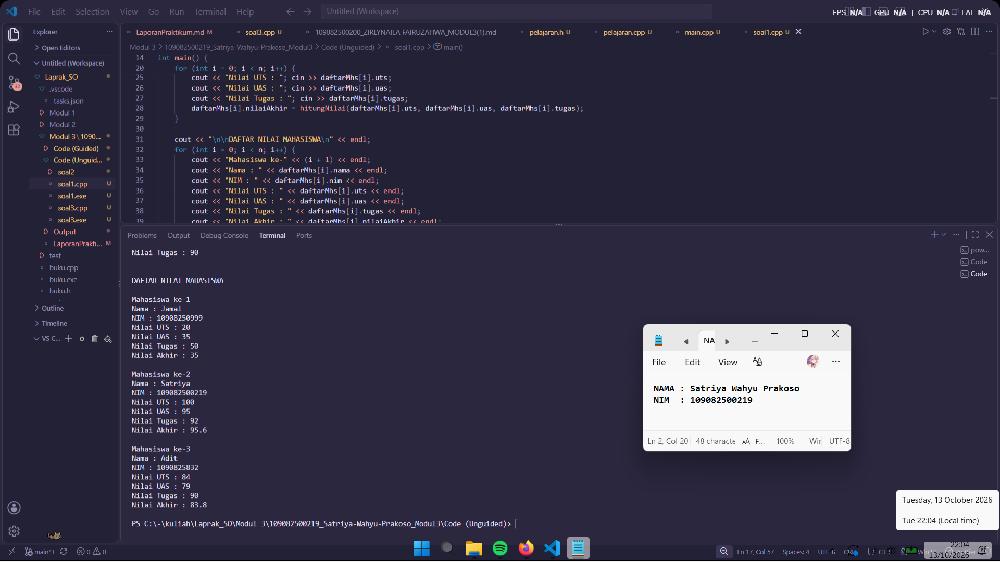
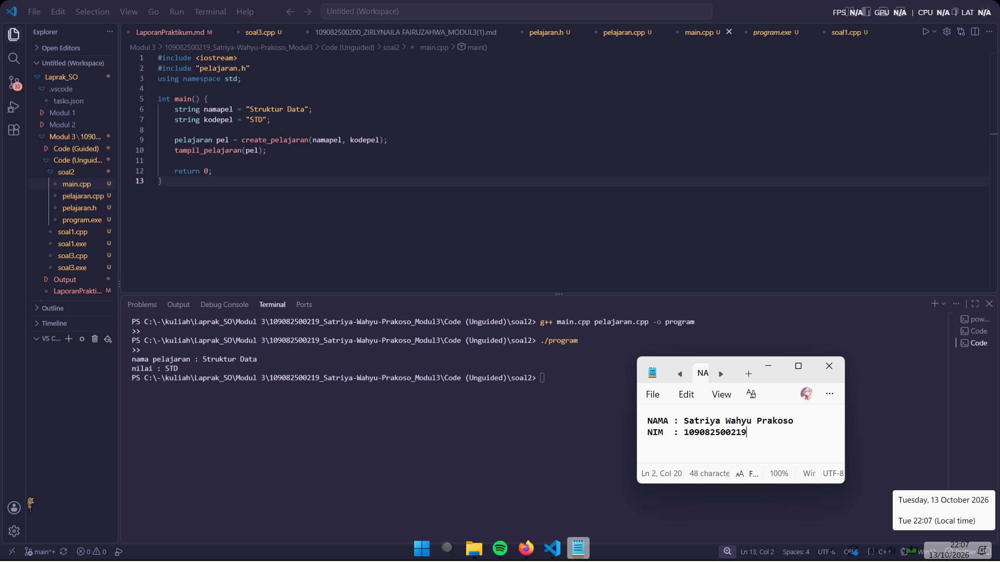
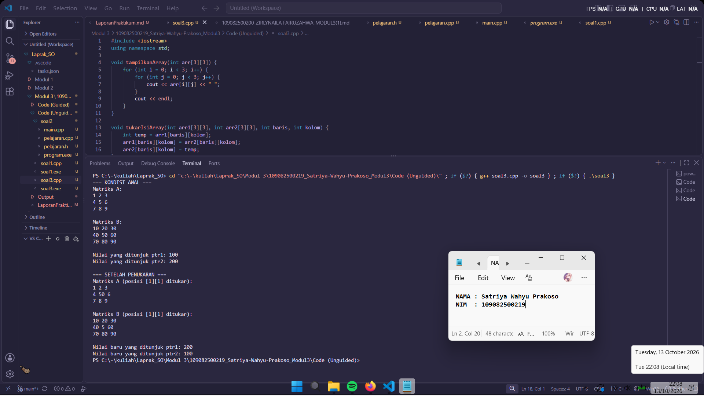

# <h1 align="center">Laporan Praktikum Modul 3 - ABSTRACT DATA TYPE (ADT)</h1>

<p align="center">Satriya Wahyu Prakoso - 109082500219</p>

## Dasar Teori

Abstract Data Type (ADT) adalah model matematika yang mendefinisikan suatu tipe data berdasarkan nilai yang dapat ditampung dan sekumpulan operasi (primitif) yang dapat dilakukan terhadap objek tersebut, tanpa memedulikan bagaimana tipe data tersebut nantinya akan diimplementasikan dalam kode program.

## A. Konsep Abstraksi Data (Data Abstraction)

1. ADT mengedepankan prinsip abstraksi data, di mana program hanya fokus pada *apa yang dilakukan* oleh data tersebut (spesifikasi), bukan *bagaimana cara* data tersebut memprosesnya (realisasi).
2. Dengan abstraksi, pengguna tipe data tidak perlu mengetahui struktur memori internal atau algoritma rumit di balik layar, melainkan cukup memanggil operasi dasar yang sudah disediakan.
3. Konsep ini memisahkan secara tegas antara deklarasi tipe data pada file antarmuka (*header* `.h`) dengan detail logika internal pada file implementasi (`.cpp`).

## B. Komponen Utama Abstract Data Type (ADT)

1. **Deklarasi Nilai (Value Definition):** Menentukan ruang lingkup nilai atau data apa saja yang dapat ditampung oleh tipe data bentukan tersebut (biasanya dibungkus dalam `struct` atau `class`).
2. **Koleksi Operasi (Operation Definition):** Menentukan sekumpulan fungsi atau prosedur dasar (primitif) yang valid untuk memanipulasi objek tipe tersebut, yang dapat dikategorikan menjadi:
   * **Konstruktor (Creator):** Berfungsi membentuk atau menginisialisasi objek baru (misalnya diawali dengan nama `create` atau `Make`).
   * **Selektor (Getter):** Berfungsi mengakses nilai atau komponen tertentu di dalam objek tanpa mengubahnya.
   * **Pengubah (Setter/Mutator):** Prosedur yang bertugas memodifikasi isi atau komponen nilai objek.
   * **Operator Lain:** Berupa operasi matematika, relasional (perbandingan), konversi, atau pembacaan/penulisan data (I/O).

## C. Karakteristik Statis dan Enkapsulasi

1. ADT bersifat statis secara definisi, artinya aturan, invarian tipe data, dan aksioma yang berlaku pada operasi tersebut sudah dirancang baku sejak awal.
2. ADT menerapkan prinsip enkapsulasi (*information hiding*), di mana perubahan struktur data internal di dalam file implementasi tidak akan mengganggu atau merusak jalannya kode program utama (*driver*) selama spesifikasi fungsi pembungkusnya tetap sama.
3. Struktur suatu ADT yang lengkap juga dapat mengandung komponen dari ADT lainnya (misalnya ADT Pelajaran atau ADT Mahasiswa yang menggunakan tipe data `string` atau struktur data bentukan lain).


## Guided

### 1. mahasiswa.h

```C++
#ifndef MAHASISWA_H_INCLUDED
#define MAHASISWA_H_INCLUDED

struct mahasiswa{
    char nim[10];
    int nilai1, nilai2;
};

void inputMhs(mahasiswa &m);
float rata2(mahasiswa m);

#endif
```

### 2. mahasiswa.cpp

```C++
#include <iostream>
#include "mahasiswa.h"

using namespace std;

void inputMhs(mahasiswa &m) {
    cout << "input nim = ";
    cin >> m.nim;
    cout << "input nilai1 = ";
    cin >> m.nilai1;
    cout << "input nilai2 = ";
    cin >> m.nilai2;
}

float rata2(mahasiswa m) {
    return float(m.nilai1 + m.nilai2) / 2;
}
```

### 3. main.cpp

```C++
#include <iostream>
#include "mahasiswa.h"

using namespace std;

int main(){
    mahasiswa mhs;
    inputMhs(mhs);
    cout << "rata-rata = " << rata2(mhs);
    return 0;
}
```

Ini adalah contoh program penerapan Abstract Data Type (ADT). Program ini berfungsi untuk menginput data mahasiswa berupa NIM serta dua buah nilai, lalu menghitung dan menampilkan nilai rata-ratanya. Struktur program ini dibagi menjadi 3 file, yaitu mahasiswa.h untuk deklarasi struktur data dan fungsi, mahasiswa.cpp untuk implementasi logika fungsi input dan perhitungan rata-rata, serta main.cpp sebagai program utama yang mengeksekusi seluruh alur program tersebut secara berurutan.

## Unguided

### 1\. Buat program yang dapat menyimpan data mahasiswa (max. 10) ke dalam sebuah array dengan field nama, nim, uts, uas, tugas, dan nilai akhir. Nilai akhir diperoleh dari FUNGSI dengan rumus 0.3*uts+0.4*uas+0.3*tugas.

```C++
#include <iostream>
#include <string>
using namespace std;

struct Mahasiswa {
    string nama, nim;
    float uts, uas, tugas, nilaiAkhir;
};

float hitungNilai(float uts, float uas, float tugas) {
    return (0.3 * uts) + (0.4 * uas) + (0.3 * tugas);
}

int main() {
    Mahasiswa daftarMhs[10];
    int n;
    cout << "Masukkan jumlah mahasiswa (maksimal 10): ";
    cin >> n;
    if (n > 10) n = 10;
    for (int i = 0; i < n; i++) {
        cout << "\nData mahasiswa ke-" << (i + 1) << endl;
        cin.ignore();
        cout << "Nama : "; getline(cin, daftarMhs[i].nama);
        cout << "NIM : "; cin >> daftarMhs[i].nim;
        cout << "Nilai UTS : "; cin >> daftarMhs[i].uts;
        cout << "Nilai UAS : "; cin >> daftarMhs[i].uas;
        cout << "Nilai Tugas : "; cin >> daftarMhs[i].tugas;
        daftarMhs[i].nilaiAkhir = hitungNilai(daftarMhs[i].uts, daftarMhs[i].uas, daftarMhs[i].tugas);
    }

    cout << "\n\nDAFTAR NILAI MAHASISWA\n" << endl;
    for (int i = 0; i < n; i++) {
        cout << "Mahasiswa ke-" << (i + 1) << endl;
        cout << "Nama : " << daftarMhs[i].nama << endl;
        cout << "NIM : " << daftarMhs[i].nim << endl;
        cout << "Nilai UTS : " << daftarMhs[i].uts << endl;
        cout << "Nilai UAS : " << daftarMhs[i].uas << endl;
        cout << "Nilai Tugas : " << daftarMhs[i].tugas << endl;
        cout << "Nilai Akhir : " << daftarMhs[i].nilaiAkhir << endl;
        cout << endl; 
    }
    return 0;
}
```

### Output Unguided 1 :

##### Output 





Program ini berfungsi untuk menyimpan dan menghitung nilai mahasiswa dengan cara membuat tipe data struct Mahasiswa sebagai wadah data komponen (nama, NIM, nilai UTS, UAS, tugas, dan nilai akhir) , kemudian ditampung ke dalam array berkapasitas maksimal 10 data. Di dalam program utama user meminta input jumlah mahasiswa, program akan membatasi jumlahnya agar tidak melebihi kapasitas array. Proses pengisian data dilakukan melalui perulangan for pertama yang dilengkapi dengan cin.ignore() dan getline agar input nama yang mengandung spasi tidak terlewat, serta langsung menghitung bobot nilai menggunakan fungsi hitungNilai dengan rumus 30% UTS, 40% UAS, dan 30% Tugas. Di akhir, data yang telah tersimpan dan terhitung tersebut akan langsung ditampilkan kembali satu per satu.

### 2\. Buatlah ADT pelajaran sebagai berikut di dalam file “pelajaran.h”:. Buatlah implementasi ADT pelajaran pada file “pelajaran.cpp”. Cobalah hasil implementasi ADT pada file “main.cpp”


```C++
pelajaran.h

#ifndef PELAJARAN_H_INCLUDED
#define PELAJARAN_H_INCLUDED
#include <string>
using namespace std;

struct pelajaran {
    string namaMapel;
    string kodeMapel;
};

pelajaran create_pelajaran(string namapel, string kodepel);
void tampil_pelajaran(pelajaran pel);

#endif
```

```C++
pelajaran.cpp

#include "pelajaran.h"
#include <iostream>
using namespace std;

pelajaran create_pelajaran(string namapel, string kodepel) {
    pelajaran pel;
    pel.namaMapel = namapel;
    pel.kodeMapel = kodepel;
    return pel;
}

void tampil_pelajaran(pelajaran pel) {
    cout << "nama pelajaran : " << pel.namaMapel << endl;
    cout << "nilai : " << pel.kodeMapel << endl;
}
```

```C++
main.cpp

#include <iostream>
#include "pelajaran.h"
using namespace std;

int main() {
    string namapel = "Struktur Data";
    string kodepel = "STD";
    
    pelajaran pel = create_pelajaran(namapel, kodepel);
    tampil_pelajaran(pel);
    
    return 0;
}
```

### Output Unguided 2 :

##### Output 



Program ini menggunakan konsep ADT. File pelajaran.h berfungsi sebagai header untuk menampung komponen data (namaMapel, kodeMapel) ke dalam struct pelajaran sekaligus mendeklarasikan prototipe fungsinya. Lalu, berkas pelajaran.cpp berisi implementasi logika atau cara kerja asli dari fungsi create_pelajaran yang berfungsi membentuk objek pelajaran baru serta prosedur tampil_pelajaran untuk mencetak isinya ke layar. Lalu, berkas main.cpp berfungsi sebagai program utama yang menyiapkan teks data awal ("Struktur Data" dan "STD"), mengeksekusi fungsi pembentuk objek, lalu memanggil prosedur penampilan data agar hasilnya dapat tercetak.

### 3\. Buatlah program dengan ketentuan :
- 2 buah array 2D integer berukuran 3x3 dan 2 buah pointer integer
- fungsi/prosedur yang menampilkan isi sebuah array integer 2D
- fungsi/prosedur yang akan menukarkan isi dari 2 array integer 2D pada posisi tertentu
- fungsi/prosedur yang akan menukarkan isi dari variabel yang ditunjuk oleh 2 buah pointer

```C++
#include <iostream>
using namespace std;

void tampilkanArray(int arr[3][3]) {
    for (int i = 0; i < 3; i++) {
        for (int j = 0; j < 3; j++) {
            cout << arr[i][j] << " ";
        }
        cout << endl;
    }
}

void tukarIsiArray(int arr1[3][3], int arr2[3][3], int baris, int kolom) {
    int temp = arr1[baris][kolom];
    arr1[baris][kolom] = arr2[baris][kolom];
    arr2[baris][kolom] = temp;
}

void tukarPointer(int *p1, int *p2) {
    int temp = *p1;
    *p1 = *p2;
    *p2 = temp;
}

int main() {
    int matriksA[3][3] = {
        {1, 2, 3},
        {4, 5, 6},
        {7, 8, 9}
    };
    
    int matriksB[3][3] = {
        {10, 20, 30},
        {40, 50, 60},
        {70, 80, 90}
    };

    int var1 = 100;
    int var2 = 200;
    int *ptr1 = &var1;
    int *ptr2 = &var2;

    cout << "=== KONDISI AWAL ===" << endl;
    cout << "Matriks A:" << endl;
    tampilkanArray(matriksA);
    cout << "\nMatriks B:" << endl;
    tampilkanArray(matriksB);
    cout << "\nNilai yang ditunjuk ptr1: " << *ptr1 << endl;
    cout << "Nilai yang ditunjuk ptr2: " << *ptr2 << endl;

    tukarIsiArray(matriksA, matriksB, 1, 1);
    tukarPointer(ptr1, ptr2);

    cout << "\n=== SETELAH PENUKARAN ===" << endl;
    cout << "Matriks A (posisi [1][1] ditukar):" << endl;
    tampilkanArray(matriksA);
    cout << "\nMatriks B (posisi [1][1] ditukar):" << endl;
    tampilkanArray(matriksB);
    cout << "\nNilai baru yang ditunjuk ptr1: " << *ptr1 << endl;
    cout << "Nilai baru yang ditunjuk ptr2: " << *ptr2 << endl;

    return 0;
}
```

### Output Unguided 3 :

##### Output 



Program ini mengubah dan memindahkan isi data menggunakan tabel angka (array 2D) dan penunjuk data (pointer). Fungsi tampilkanArray berfungsi untuk mencetak semua isi tabel berukuran 3x3 ke layar agar rapi. Fungsi tukarIsiArray digunakan untuk menukar angka antara tabel A dan tabel B pada posisi baris dan kolom tertentu yang kita pilih. Fungsi tukarPointer dipakai untuk menukar isi dari dua variabel secara langsung lewat bantuan alamat memorinya. Di dalam bagian main, semua fungsi ini dicoba dengan cara menyiapkan dua tabel angka dan dua variabel awal, menampilkan isinya sebelum diubah, melakukan proses penukaran angka, lalu memunculkan kembali hasil akhirnya.

## Kesimpulan

Praktikum ini membuat saya bisa belajar cara merapikan kode program menggunakan konsep ADT, memisahkan tempat untuk membuat rumus tipe data di file .h dan tempat untuk menulis cara kerja fungsinya di file .cpp. Praktikum ini juga memperlihatkan cara mengatur angka di dalam tabel matematika pada posisi baris dan kolom tertentu lewat bantuan perulangan. Pointer sangat berguna untuk mengubah isi suatu variabel secara langsung lewat alamat memorinya tanpa perlu menyalin data baru.

## Referensi

\[1\] Triase. (2020). Diktat Edisi Revisi: Struktur Data. Medan: Universitas Islam Negeri Sumatera Utara Medan.
\[2\] Baeldung. (2024). What Is Abstract Data Type?. Tersedia di: Baeldung on Computer Science
