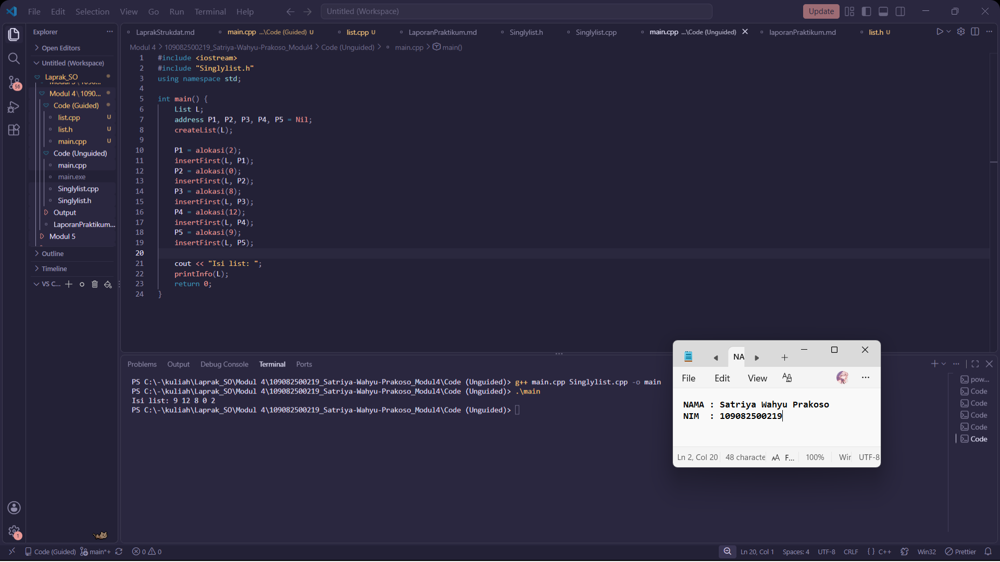

# <h1 align="center">Laporan Praktikum Modul 4 - SINGLY LINKED LIST (BAGIAN PERTAMA)</h1>

<p align="center">Satriya Wahyu Prakoso - 109082500219</p>

## Dasar Teori

Linked List adalah koleksi linear berupa nodes yang saling terhubung melalui pointer dan merepresentasikan suatu urutan linier (sequence).

## A. Konsep Single Linked List

1. Single linked list merupakan linked list yang hanya memiliki satu pointer penghubung ke node lain.
2. Terdapat pointer utama bernama HEAD yang berfungsi menunjuk ke node pertama dalam linked list.
3. Kondisi empty (kosong) terjadi jika nilai pointer HEAD bernilai NULL atau Nil.

## B. Operasi Dasar Single Linked List

1. Push (Insert): Operasi penambahan data, yang mencakup pushDepan (penambahan di awal) dan pushBelakang (penambahan di akhir).
2. Pop (Delete): Operasi penghapusan data, yang mencakup popDepan (penghapusan data awal) dan popBelakang (penghapusan data akhir).
3. Traversal (Melihat Data): Proses penelusuran untuk membaca, memeriksa, dan menampilkan seluruh isi data pada node.

## C. Komponen Tambahan dan Alokasi Memori

1. Umumnya, implementasi single linked list cukup menggunakan HEAD sebagai pointer utama yang menunjuk ke awal data.
2. Penambahan pointer TAIL dapat diterapkan untuk menunjuk langsung ke node terakhir demi mempermudah proses operasi di bagian belakang.
3. Alokasi memori dinamis memanfaatkan pustaka seperti `malloc.h` pada bahasa C atau operator `new` dan `delete` pada C++ untuk memesan serta menghapus tempat di memori secara manual.

## Guided

### 1. list.h

```C++
#ifndef List_h
#define List_h
#define Nil NULL

#include <iostream>
using namespace std;

struct mahasiswa
{
    string nama, nim;
    int umur;
};

typedef mahasiswa dataMahasiswa;
typedef struct node *address;

struct node
{
    dataMahasiswa isidata;
    address next;
};

struct linkedlist
{
    address first;
};

bool isEmpty(linkedlist List);
void createList(linkedlist &List);
address alokasi(string nama, string nim, int umur);
void dealokasi(address &node);
void printList(linkedlist List);
void insertFirst(linkedlist &list, address nodeBaru);
void insertAfter(linkedlist &list, address nodeBaru, address prev);
void insertLast(linkedlist &list, address nodeBaru);

void delFirst(linkedlist &list);
void delLast(linkedlist &list);
void delAfter(linkedlist &list, address nodeHapus, address nodePrev);
int nbList(linkedlist list);
void deleteList(linkedlist &list);
#endif
```

### 2. list.cpp

```C++
#include "list.h"
#include <iostream>
using namespace std;

bool isEmpty(linkedlist  List)
{
    if (List.first == Nil)
    {
        return true;
    }
    else 
    {
        return false;
    }
}

void createList(linkedlist &List)
{
    List.first = Nil;
}

address alokasi(string nama, string nim, int umur)
{
    address nodeBaru = new node;
    nodeBaru->isidata.nama = nama;
    nodeBaru->isidata.nim = nim;
    nodeBaru->isidata.umur = umur;
    nodeBaru->next = Nil;
    return nodeBaru;
}

void dealokasi(address &node)
{
    node->next = Nil;
    delete node;
}

void insertFirst(linkedlist &List, address nodeBaru)
{
    nodeBaru->next = List.first;
    List.first = nodeBaru;
}

void insertAfter(linkedlist &List, address nodeBaru, address Prev)
{
    if (Prev != Nil)
    {
        nodeBaru->next = Prev->next;
        Prev->next = nodeBaru;
    }
    else
    {
        cout << "Node sebelumnya tidak valid!" << endl;
    }
}

void insertLast(linkedlist &List, address nodeBaru)
{
    if (isEmpty(List))
    {
        List.first = nodeBaru;
    }
    else
    {
        address nodeBantu = List.first;
        while (nodeBantu->next != Nil)
        {
            nodeBantu = nodeBantu->next;
        }
        nodeBantu->next = nodeBaru;
    }
}

void delFirst(linkedlist &List)
{
    address nodeHapus;
    if (isEmpty(List) == false)
    {
        nodeHapus = List.first;
        List.first = List.first->next;
        nodeHapus->next = Nil;
        dealokasi(nodeHapus);
    }
    else
    {
        cout << "List kosong!" << endl;
    }
}

void delLast(linkedlist &List)
{
    address nodeHapus, nodePrev;
    if (isEmpty(List) == false)
    {
        nodeHapus = List.first;
        if (nodeHapus->next == Nil)
        {
            List.first->next = Nil;
            dealokasi(nodeHapus);
        }
        else
        {
            while (nodeHapus->next != Nil)
            {
                nodePrev = nodeHapus;
                nodeHapus = nodeHapus->next;
            }
            nodePrev->next = Nil;
            dealokasi(nodeHapus);
        }
    }
    else
    {
        cout << "List kosong" << endl;
    }
}

void delAfter(linkedlist &List, address nodeHapus, address nodePrev)
{
    if (isEmpty(List) == true)
    {
        cout << "List kosong!" << endl;
    }
    else
    {
        if (nodePrev != Nil && nodePrev->next != Nil)
        {
            nodeHapus = nodePrev->next;
            nodePrev->next = nodeHapus->next;
            nodeHapus->next = Nil;
            dealokasi(nodeHapus);
        }
        else
        {
            cout << "Node sebelumnya (prev) tidak valid!" << endl;
        }
    }
}

void printList(linkedlist list)
{
    if (isEmpty(list) == true)
    {
        cout << "List kosong!" << endl;
    }
    else
    {
        address nodeBantu = list.first;
        while (nodeBantu != Nil)
        {
            cout << "Nama: " << nodeBantu->isidata.nama << ", NIM: " << nodeBantu->isidata.nim << ", Usia: " << nodeBantu->isidata.umur << endl;
            nodeBantu = nodeBantu->next;
        }
    }
}

int nbList(linkedlist list)
{
    int count = 0;
    address nodeBantu = list.first;
    while (nodeBantu != Nil)
    {
        count++;
        nodeBantu = nodeBantu->next;
    }
    return count;
}

void deleteList(linkedlist &list)
{
    address nodeBantu, nodeHapus;
    nodeBantu = list.first;
    while (nodeBantu != Nil)
    {
        nodeHapus = nodeBantu;
        nodeBantu = nodeBantu->next;
        dealokasi(nodeHapus);
    }
    list.first = Nil;
    cout << "List sudah terhapus." << endl;
}
```

### 3. main.cpp

```C++
#include "list.h"
using namespace std;

int main()
{
    linkedlist List;
    address nodeA, nodeB, nodeC, nodeD, nodeE = Nil;
    createList(List);

    nodeA = alokasi("Dhimas", "2311102151", 20);
    nodeB = alokasi("Arvin", "221110014", 21);
    nodeC = alokasi("Rizal", "231110029", 20);
    nodeD = alokasi("Satrio", "2211102173", 21);
    nodeE = alokasi("Joshua", "2311102133", 21);

    insertFirst(List, nodeA);
    insertLast(List, nodeB);
    insertAfter(List, nodeC, nodeA);
    insertAfter(List, nodeD, nodeC);
    insertLast(List, nodeE);

    cout << "--- ISI LIST SETELAH DILAKUKAN INSERT ---" << endl;
    printList(List);
    cout << "jumlah node : " << nbList(List) << endl;
    cout << endl;

    delFirst(List);
}
```

Program ini berguna untuk mengatur data mahasiswa yang berisi nama, NIM, dan umur. File list.h yang dipakai untuk mengenalkan struktur data node, pointer address, dan daftar fungsi dasar untuk membuat list. File list.cpp berisi logika atau cara kerja dari fungsi-fungsi tersebut, cara memesan memori , menambah data, mengecek list kosong , dan menghapus data. File main.cpp adalah program utama yang memanggil file-file tersebut agar data mahasiswa yang dimasukkan bisa diproses dan hasilnya muncul.

## Unguided

### 1\. Buat ADT singly linked list dengan `infotype` bertipe integer, `address` sebagai pointer ke `ElmList`, serta operasi `createList`, `alokasi`, `dealokasi`, `printInfo`, dan `insertFirst`.

**`Singlylist.h`**

```C++
#ifndef SINGLYLIST_H
#define SINGLYLIST_H

#include <string>
using namespace std;

#define Nil nullptr

typedef int infotype;
struct ElmList;
typedef ElmList *address;

struct ElmList {
    infotype info;
    address next;
};

struct List {
    address first;
};

bool isEmpty(List L);
void createList(List &L);
address alokasi(infotype info);
void dealokasi(address &P);
void printInfo(List L);
void insertFirst(List &L, address P);

#endif
```

**`Singlylist.cpp`**

```C++
#include <iostream>
#include "Singlylist.h"
using namespace std;

bool isEmpty(List L) {
    return L.first == Nil;
}

void createList(List &L) {
    L.first = Nil;
}

address alokasi(infotype info) {
    address P = new ElmList;
    P->info = info;
    P->next = Nil;
    return P;
}

void dealokasi(address &P) {
    delete P;
    P = Nil;
}

void printInfo(List L) {
    address P = L.first;
    while (P != Nil) {
        cout << P->info << " ";
        P = P->next;
    }
    cout << endl;
}

void insertFirst(List &L, address P) {
    P->next = L.first;
    L.first = P;
}
```

**`main.cpp`**

```C++
#include <iostream>
#include "Singlylist.h"
using namespace std;

int main() {
    List L;
    address P1, P2, P3, P4, P5 = Nil;
    createList(L);

    P1 = alokasi(2);
    insertFirst(L, P1);
    P2 = alokasi(0);
    insertFirst(L, P2);
    P3 = alokasi(8);
    insertFirst(L, P3);
    P4 = alokasi(12);
    insertFirst(L, P4);
    P5 = alokasi(9);
    insertFirst(L, P5);

    cout << "Isi list: ";
    printInfo(L);
    return 0;
}
```

### Output Unguided 1 :

##### Output 



Program unguided ini berfungsi untuk menyimpan data integer. Pertama-tama dibuat dulu sebuah list kosong memakai fungsi createList. Setiap ada angka baru yang mau dimasukkan, fungsi alokasi menyiapkan kotak baru di memori. Kemudian kotak-kotaknya dimasukkan ke dalam list dari urutan paling depan memakai fungsi insertFirst. Prosesnya kotak baru tersebut disambung ke elemen pertama yang sudah ada, lalu penanda awal list digeser ke kotak yang baru masuk. Fungsi printInfo menelusuri seluruh isi list dari awal sampai akhir untuk menampilkan semua angka yang sudah tersimpan.

## Kesimpulan

Singly Linked List adalah struktur data yang sangat fleksibel untuk menambah atau menghapus data memakai pointer. Praktikum ini membuat saya menjadi paham pentingnya fungsi alokasi dan dealokasi untuk mengatur memori sistem secara manual supaya programnya tidak error atau boros memori.

## Referensi

\[1\] Triase. (2020). Diktat Edisi Revisi: Struktur Data. Medan: Universitas Islam Negeri Sumatera Utara Medan.
\[2\] School of Computer Science BINUS University. (2017). Single Linked List. Jakarta: BINUS University.