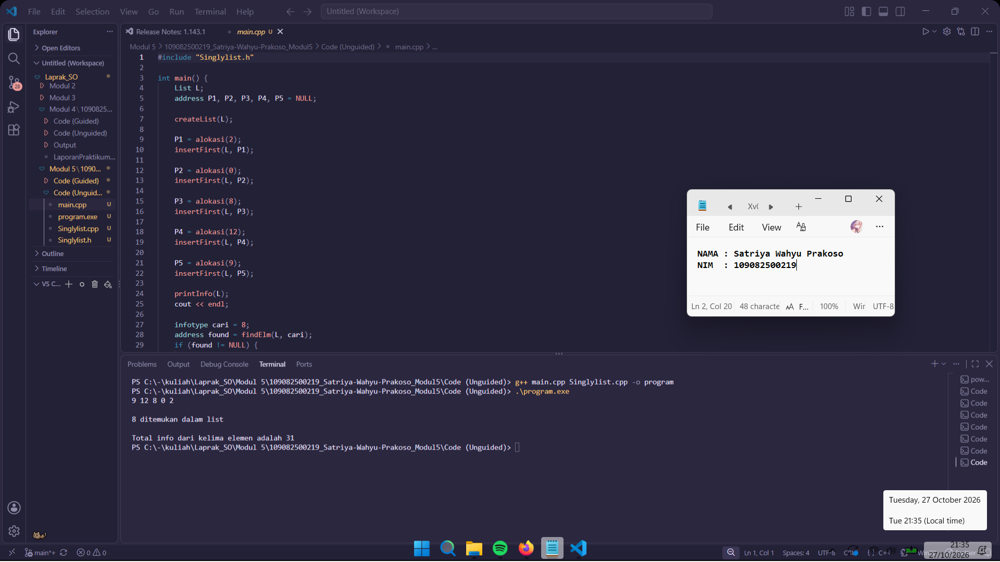

# <h1 align="center">Laporan Praktikum Modul 5 - SINGLY LINKED LIST (BAGIAN KEDUA)</h1>

<p align="center">Satriya Wahyu Prakoso - 109082500219</p>


## Dasar Teori

Single Linked List adalah sebuah struktur data dinamis yang terdiri dari sejumlah elemen (disebut sebagai node) yang terhubung secara linier. Berbeda dengan array yang mengalokasikan memori secara berurutan sejak awal, Linked List mengalokasikan memori secara dinamis menggunakan pointer di mana setiap elemen saling menunjuk ke elemen berikutnya.

## A. Konsep Abstraksi Data (Data Abstraction)

1. Setiap elemen atau node di dalam list setidaknya terbagi menjadi dua bagian utama, yaitu bagian nilai (data/info) dan bagian penunjuk (pointer next) ke elemen berikutnya.
2. Penunjuk arah link bersifat satu arah (singly), dimulai dari gerbang awal menuju ke elemen-elemen selanjutnya hingga mencapai elemen terakhir.
3. Akhir dari rantai elemen ditandai dengan nilai penunjuk penutup, yaitu NULL atau Nil, yang menandakan bahwa tidak ada elemen lagi setelahnya.

## B. Komponen Utama Abstract Data Type (ADT)

1. Deklarasi Nilai (Value Definition): Menentukan struktur dari objek komponen yang digunakan di dalam list.
	• Node (TNode): Struktur dasar pembentuk list yang menampung variabel nilai atau data (misalnya int data) dan variabel pointer alamat (TNode *next).
	• Head: Variabel pointer penanda atau gerbang utama yang menyimpan alamat memori elemen pertama di dalam list. Jika head = NULL, artinya list dalam keadaan kosong.
2. Koleksi Operasi (Operation Definition): Menentukan sekumpulan fungsi atau prosedur dasar (primitif) untuk melakukan manipulasi atau pengolahan data pada linked list:
	• Inisialisasi (Create): Operasi awal untuk membentuk list baru dengan mengosongkan nilai pointer head ke kondisi NULL.
	• Sisip (Insertion): Operasi menambahkan node baru ke dalam list, baik diletakkan di posisi awal (Insert First), di posisi akhir (Insert Last), atau di posisi tengah/tertentu (Insert After).
	• Hapus (Deletion): Operasi mengeluarkan atau menghapus node dari list, yang juga dapat dilakukan dari posisi depan (Delete First), posisi belakang (Delete Last), atau posisi tengah (Delete After).
	• Cetak (Traversal/Read): Prosedur untuk menelusuri list dari elemen pertama (head) sampai elemen terakhir untuk menampilkan seluruh isi data ke layar.

## C. Karakteristik Statis dan Enkapsulasi

1. Linked list bersifat dinamis, artinya ukuran atau kapasitas wadah datanya tidak perlu ditentukan di awal program dan bisa membesar atau mengecil secara fleksibel saat program berjalan.
2. Setiap kali menambah data, program melakukan proses Alokasi menggunakan perintah memori dinamis (new), dan sebaliknya melakukan Dealokasi (delete) saat data dihapus untuk membebaskan ruang memori komputer.
3. Proses pencarian atau penelusuran data pada linked list selalu dimulai dari head dan bergerak secara bertahap satu per satu, sehingga struktur data ini sangat bergantung pada efisiensi logika perulangan (looping).

Abstract Data Type (ADT) adalah model matematika yang mendefinisikan suatu tipe data berdasarkan nilai yang dapat ditampung dan sekumpulan operasi (primitif) yang dapat dilakukan terhadap objek tersebut, tanpa memedulikan bagaimana tipe data tersebut nantinya akan diimplementasikan dalam kode program.

## Guided

### 1. list.h

```C++
#ifndef List_h
#define List_h
#define Nil NULL

#include <iostream>
using namespace std;

struct mahasiswa
{
    string nama, nim;
    int umur;
};

typedef mahasiswa dataMahasiswa;
typedef struct node *address;

struct node
{
    dataMahasiswa isidata;
    address next;
};

struct linkedList
{
    address first;
};

bool isEmpty(linkedList List);
void createList(linkedList &List);
address alokasi(string nama, string nim, int umur);
void dealokasi(address &node);
void printList(linkedList List);
void insertFirst(linkedList &List, address nodeBaru);
void insertLast(linkedList &List, address nodeBaru);
void insertAfter(linkedList &List, address nodeBaru, address prev);
void delFirst(linkedList &List);
void delLast(linkedList &List);
void delAfter(linkedList &List, address nodeHapus, address nodePrev);
int nbList(linkedList List);
void deleteList(linkedList &List);

address FindNodebyData(linkedList List, string data);
void FindNodebyAddress(linkedList List, address node);
void FindNodeByRange(linkedList List, int nilaiAwal, int nilaiAkhir);

void updateFirst(linkedList &list);
void updateLast(linkedList &list);
void updateAfter(linkedList &list, address &prev);
void updateByNim(linkedList &list, string nim);

#endif
```

### 2. list.cpp

```C++
#include "list.h"
#include <iostream>
using namespace std;

// I.S = Initial State / kondisi awal
// F.S = Final State / kondisi akhir

// fungsi untuk cek apakah list kosong atau tidak
bool isEmpty(linkedList List)
{
    if (List.first == Nil)
    {
        return true;
    }
    else
    {
        return false;
    }
}

// pembuatan linked list kosong
void createList(linkedList &List)
{
    /* I.S. sembarang
       F.S. terbentuk list kosong */
    List.first = Nil;
}

// pembuatan node baru dengan menerapkan manajemen memori
address alokasi(string nama, string nim, int umur)
{
    /* I.S. sembarang
       F.S. mengembalikan alamat node baru dengan isidata = sesuai parameter dan next = Nil */
    address nodeBaru = new node;
    nodeBaru->isidata.nama = nama;
    nodeBaru->isidata.nim = nim;
    nodeBaru->isidata.umur = umur;
    nodeBaru->next = Nil;
    return nodeBaru;
}

// penghapusan node dengan menerapkan manajemen memori
void dealokasi(address &node)
{
    /* I.S. P terdefinisi
       F.S. memori yang digunakan node dikembalikan ke sistem */
    node->next = Nil;
    delete node;
}

// prosedur-prosedur untuk insert / menambahkan node baru kedalam list
void insertFirst(linkedList &List, address nodeBaru)
{
    /* I.S. sembarang, P sudah dialokasikan
       F.S. menempatkan elemen list (node) pada awal list */
    nodeBaru->next = List.first;
    List.first = nodeBaru;
}

void insertAfter(linkedList &List, address nodeBaru, address Prev)
{
    /* I.S. sembarang, nodeBaru dan Prev alamat salah satu elemen list (node)
       F.S. menempatkan elemen (node) sesudah elemen node Prev */
    if (Prev != Nil)
    {
        nodeBaru->next = Prev->next;
        Prev->next = nodeBaru;
    }
    else
    {
        cout << "Node sebelumnya tidak valid!" << endl;
    }
}

void insertLast(linkedList &List, address nodeBaru)
{
    /* I.S. sembarang, nodeBaru sudah dialokasikan
       F.S. menempatkan elemen nodeBaru pada akhir list */
    if (isEmpty(List))
    {
        List.first = nodeBaru;
    }
    else
    {
        address nodeBantu = List.first;
        while (nodeBantu->next != Nil)
        {
            nodeBantu = nodeBantu->next;
        }
        nodeBantu->next = nodeBaru;
    }
}

// prosedur-prosedur untuk delete / menghapus node yang ada didalam list
void delFirst(linkedList &List)
{
    /* I.S. list tidak kosong
    F.S. node pertama di list terhapus*/
    address nodeHapus;
    if (isEmpty(List) == false)
    {
        nodeHapus = List.first;
        List.first = List.first->next;
        nodeHapus->next = Nil;
        dealokasi(nodeHapus);
    }
    else
    {
        cout << "List kosong!" << endl;
    }
}

void delLast(linkedList &List)
{
    /* I.S. list tidak kosong
    F.S. node terakhir di list terhapus */
    address nodeHapus, nodePrev;
    if (isEmpty(List) == false)
    {
        nodeHapus = List.first;
        if (nodeHapus->next == Nil)
        {
            List.first->next = Nil;
            dealokasi(nodeHapus);
        }
        else
        {
            while (nodeHapus->next != Nil)
            {
                nodePrev = nodeHapus;
                nodeHapus = nodeHapus->next;
            }
            nodePrev->next = Nil;
            dealokasi(nodeHapus);
        }
    }
    else
    {
        cout << "list kosong" << endl;
    }
}

void delAfter(linkedList &List, address nodeHapus, address nodePrev)
{
    /* I.S. list tidak kosng, Prev alamat salah satu elemen list
    F.S. nodeBantu adalah alamat dari Prev→next, menghapus Prev→next dari list */
    if (isEmpty(List) == true)
    {
        cout << "List kosong!" << endl;
    }
    else
    { // jika list tidak kosong
        if (nodePrev != Nil && nodePrev->next != Nil)
        {
            nodeHapus = nodePrev->next;
            nodePrev->next = nodeHapus->next;
            nodeHapus->next = Nil;
            dealokasi(nodeHapus);
        }
        else
        {
            cout << "Node sebelumnya (prev) tidak valid!" << endl;
        }
    }
}

// prosedur untuk menampilkan isi list
void printList(linkedList List)
{
    /* I.S. list mungkin kosong
       F.S. jika list tidak kosong menampilkan semua info yang ada pada list */
    if (isEmpty(List))
    {
        cout << "List kosong." << endl;
    }
    else
    {
        address nodeBantu = List.first;
        while (nodeBantu != Nil)
        {
            cout << "Nama : " << nodeBantu->isidata.nama << ", NIM : " << nodeBantu->isidata.nim << ", Usia : " << nodeBantu->isidata.umur << endl;
            nodeBantu = nodeBantu->next;
        }
    }
}

// function untuk menampilkan jumlah node didalam list
int nbList(linkedList List)
{
    /* I.S. list sudah ada
       F.S. menampilkan jumlah node didalam list*/
    int count = 0;
    address nodeBantu = List.first;
    while (nodeBantu != Nil)
    {
        count++;
        nodeBantu = nodeBantu->next;
    }
    return count;
}

// prosedur untuk menghapus list (menghapus semua node didalam list)
void deleteList(linkedList &List)
{
    /* I.S. list sudah ada
       F.S. menghapus semua node didalam list*/
    address nodeBantu, nodeHapus;
    nodeBantu = List.first;
    while (nodeBantu != Nil)
    {
        nodeHapus = nodeBantu;
        nodeBantu = nodeBantu->next;
        dealokasi(nodeHapus);
    }
    List.first = Nil;
    cout << "List sudah terhapus!" << endl;
}

// prosedur-prosedur untuk melakukan update data node
void updateFirst(linkedList &list)
{
    dataMahasiswa newData;
    cout << "Masukan nama baru : ";
    cin >> newData.nama;
    cout << "Masukan nim baru : ";
    cin >> newData.nim;
    cout << "Masukan umur baru : ";
    cin >> newData.umur;
    list.first->isidata = newData;
}

void updateLast(linkedList &list)
{
    if (isEmpty(list))
    {
        cout << "List kosong!" << endl;
    }
    else
    {
        dataMahasiswa newData;
        cout << "Masukan nama baru : ";
        cin >> newData.nama;
        cout << "Masukan nim baru : ";
        cin >> newData.nim;
        cout << "Masukan umur baru : ";
        cin >> newData.umur;

        address nodeBantu = list.first;
        while (nodeBantu->next != Nil)
        {
            nodeBantu = nodeBantu->next;
        }

        nodeBantu->isidata = newData;
    }
}

void updateAfter(linkedList &list, address &prev)
{
    if (isEmpty(list))
    {
        cout << "List kosong!" << endl;
    }
    else
    {
        dataMahasiswa newData;
        cout << "Masukan nama baru : ";
        cin >> newData.nama;
        cout << "Masukan nim baru : ";
        cin >> newData.nim;
        cout << "Masukan umur baru : ";
        cin >> newData.umur;

        prev->next->isidata = newData;
    }
}

void updateByNim(linkedList &list, string nim)
{
    if (!isEmpty(list))
    {
        address nodeBantu = FindNodebyData(list, nim);

        if (nodeBantu != Nil)
        {
            dataMahasiswa newData;
            cout << "Masukan nama baru : ";
            cin >> newData.nama;
            cout << "Masukan nim baru : ";
            cin >> newData.nim;
            cout << "Masukan umur baru : ";
            cin >> newData.umur;

            nodeBantu->isidata = newData;
        }
    }
    else
    {
        cout << "List kosong!" << endl;
    }
}

// prosedur-prosedur untuk searching data didalam list
address FindNodebyData(linkedList List, string data)
{
    /* I.S. list mungkin kosong
       F.S. menampilkan node yang sesuai dengan nama atau nim yang dicari */
    if (isEmpty(List) == true)
    {
        cout << "List kosong!" << endl;
    }
    else
    {
        address nodeBantu = List.first;
        int posisi = 0;
        bool found = false;
        while (nodeBantu != Nil)
        {
            posisi++;
            if (nodeBantu->isidata.nama == data || nodeBantu->isidata.nim == data)
            {
                cout << "Data " << data << " ditemukan pada posisi ke-" << posisi << "!" << endl;
                cout << "Nama : " << nodeBantu->isidata.nama << ", NIM : " << nodeBantu->isidata.nim << ", Usia : " << nodeBantu->isidata.umur << endl;
                found = true;
                break;
            }
            nodeBantu = nodeBantu->next;
        }
        if (found == false)
        {
            cout << "Node dengan data " << data << " tidak ditemukan!" << endl;
        }
    }
    cout << endl;
    return Nil;
}

void FindNodebyAddress(linkedList List, address node)
{
    /* I.S. list mungkin kosong
       F.S. menampilkan node yang sesuai dengan alamat yang dicari */
    if (isEmpty(List) == true)
    {
        cout << "List kosong!" << endl;
    }
    else
    {
        address nodeBantu = List.first;
        int posisi = 0;
        bool found = false;
        while (nodeBantu != Nil)
        {
            posisi++;
            if (nodeBantu == node)
            {
                cout << "Node ditemukan pada posisi ke-" << posisi << "!" << endl;
                cout << "Alamat Node : " << nodeBantu << endl;
                cout << "Nama : " << nodeBantu->isidata.nama << ", NIM : " << nodeBantu->isidata.nim << ", Usia : " << nodeBantu->isidata.umur << endl;
                found = true;
                break;
            }
            nodeBantu = nodeBantu->next;
        }
        if (found == false)
        {
            cout << "Node dengan alamat " << node << " tidak ditemukan dalam list!" << endl;
        }
    }
    cout << endl;
}

void FindNodeByRange(linkedList List, int nilaiAwal, int nilaiAkhir)
{
    /* I.S. list mungkin kosong
       F.S. menampilkan semua node yang memiliki umur di dalam rentang nilaiAwal sampai nilaiAkhir */
    if (isEmpty(List) == true)
    {
        cout << "List kosong!" << endl;
    }
    else
    {
        address nodeBantu = List.first;
        int posisi = 0;
        bool found = false;
        cout << "--- Data diatas usia " << nilaiAwal << " dan dibawah " << nilaiAkhir << " ---" << endl;
        while (nodeBantu != Nil)
        {
            posisi++;
            int umur = nodeBantu->isidata.umur;
            if (umur > nilaiAwal && umur < nilaiAkhir)
            {
                cout << "Data ditemukan pada posisi ke-" << posisi << " :" << endl;
                cout << "Nama : " << nodeBantu->isidata.nama << ", NIM : " << nodeBantu->isidata.nim << ", Usia : " << nodeBantu->isidata.umur << endl;
                found = true;
            }
            nodeBantu = nodeBantu->next;
        }
        if (found == false)
        {
            cout << "Tidak ada data node dalam range tersebut!" << endl;
        }
    }
    cout << endl;
}
```

### 3. main.cpp

```C++
#include <iostream>
#include "list.h"
using namespace std;

int main()
{
    linkedList List;
    address nodeA, nodeB, nodeC, nodeD, nodeE = Nil;
    createList(List);

    nodeA = alokasi("Dhimas", "2311102151", 20);
    nodeB = alokasi("Arvin", "2211110014", 21);
    nodeC = alokasi("Rizal", "2311110029", 20);
    nodeD = alokasi("Satrio", "2211102173", 21);
    nodeE = alokasi("Joshua", "2311102133", 21);

    insertFirst(List, nodeA);
    insertLast(List, nodeB);
    insertAfter(List, nodeC, nodeA);
    insertAfter(List, nodeD, nodeC);
    insertLast(List, nodeE);

    cout << "--- ISI LIST SETELAH DILAKUKAN INSERT ---" << endl;
    printList(List);
    cout << "jumlah node : " << nbList(List) << endl;
    cout << endl;

    // updateFirst(List);
    // cout << "--- ISI LIST SETELAH DILAKUKAN UPDATE FIRST ---" << endl;
    // printList(List);

    // updateLast(List);
    // cout << "--- ISI LIST SETELAH DILAKUKAN UPDATE LAST ---" << endl;
    // printList(List);

    updateAfter(List, nodeC);
    cout << "--- ISI LIST SETELAH DILAKUKAN UPDATE AFTER ---" << endl;
    printList(List);

    updateByNim(List, "2211110014");
    cout << "--- ISI LIST SETELAH DILAKUKAN UPDATE BY NIM ---" << endl;
    printList(List);

    return 0;
}
```
Program menjalankan prosedur createList untuk membuat list kosong dengan mengatur pointer first menjadi Nil (NULL). Lalu, fungsi alokasi digunakan untuk membuat node baru yang menyimpan data nama, NIM, dan umur mahasiswa. Pada proses penyisipan (insertFirst, insertLast, dan insertAfter), program mengatur pointer next agar node baru terhubung ke dalam list sesuai posisi yang ditentukan. Pada proses penghapusan (delFirst, delLast, dan delAfter), program mengatur ulang pointer untuk memutus hubungan dengan node yang akan dihapus, kemudian membebaskan memorinya menggunakan prosedur dealokasi. Program dapat menampilkan data melalui printList, menghitung jumlah node menggunakan nbList dan melakukan pencarian dan pembaruan data mahasiswa. Proses tersebut dilakukan dengan menelusuri node dari first menggunakan pointer bantuan hingga mencapai akhir list yang ditandai dengan Nil.

## Unguided

### 1\.Implementasi ADT Singly Linked List

**`Singlylist.h`**

```C++
#ifndef SINGLYLIST_H
#define SINGLYLIST_H

#include <iostream>
using namespace std;

typedef int infotype;
typedef struct ElmList *address;

struct ElmList {
    infotype info;
    address next;
};

struct List {
    address First;
};

void createList(List &L);
address alokasi(infotype x);
void dealokasi(address &P);
void printInfo(List L);
void insertFirst(List &L, address P);
address findElm(List L, infotype x);
int sumInfo(List L);

#endif
```

**`Singlylist.cpp`**

```C++
#include "Singlylist.h"

void createList(List &L) {
    L.First = NULL;
}

address alokasi(infotype x) {
    address P = new ElmList;
    if (P != NULL) {
        P->info = x;
        P->next = NULL;
    }
    return P;
}

void dealokasi(address &P) {
    delete P;
    P = NULL;
}

void printInfo(List L) {
    address P = L.First;
    while (P != NULL) {
        cout << P->info << " ";
        P = P->next;
    }
    cout << endl;
}

void insertFirst(List &L, address P) {
    if (P != NULL) {
        P->next = L.First;
        L.First = P;
    }
}

address findElm(List L, infotype x) {
    address P = L.First;
    while (P != NULL) {
        if (P->info == x) {
            return P;
        }
        P = P->next;
    }
    return NULL;
}

int sumInfo(List L) {
    int total = 0;
    address P = L.First;
    while (P != NULL) {
        total += P->info;
        P = P->next;
    }
    return total;
}
```

**`main.cpp`**

```C++
#include "Singlylist.h"

int main() {
    List L;
    address P1, P2, P3, P4, P5 = NULL;
    
    createList(L);
    
    P1 = alokasi(2);
    insertFirst(L, P1);
    
    P2 = alokasi(0);
    insertFirst(L, P2);
    
    P3 = alokasi(8);
    insertFirst(L, P3);
    
    P4 = alokasi(12);
    insertFirst(L, P4);
    
    P5 = alokasi(9);
    insertFirst(L, P5);
    
    printInfo(L);
    cout << endl;

    infotype cari = 8;
    address found = findElm(L, cari);
    if (found != NULL) {
        cout << found->info << " ditemukan dalam list" << endl;
    } else {
        cout << cari << " tidak ditemukan dalam list" << endl;
    }
    cout << endl;

    int total = sumInfo(L);
    cout << "Total info dari kelima elemen adalah " << total << endl;
    
    return 0;
}
```

### Output Unguided 1 :

##### Output 



Prosedur createList mengatur pointer First menjadi NULL untuk menandakan kalau list masih kosong. Fungsi alokasi digunakan untuk membuat node baru, menyimpan nilai angka pada variabel info, dan mengatur pointer next menjadi NULL. Setiap node kemudian dimasukkan ke awal list menggunakan prosedur insertFirst, membuat urutan data menjadi terbalik dari urutan penyisipannya. Untuk menampilkan data, prosedur printInfo menelusuri setiap node mulai dari First menggunakan pointer P hingga mencapai NULL. Fungsi findElm menggunakan proses penelusuran yang mirip untuk mencari nilai tertentu, sedangkan fungsi sumInfo menjumlahkan seluruh nilai dalam list dengan menambahkan setiap nilai info ke variabel total. Pada program utama, lima angka, yaitu 2, 0, 8, 12, dan 9, dimasukkan ke dalam list, kemudian program menampilkan seluruh elemen, mencari angka 8, dan menghitung total nilai seluruh elemen.

## Kesimpulan

Saya mempelajari cara membuat list, mengalokasikan memori, menambahkan dan menghapus node, serta menampilkan dan mencari data. Saya juga mempelajari cara menghitung jumlah node dan menjumlahkan nilai seluruh elemen dalam list. Praktikum ini membantu saya memahami penggunaan pointer untuk menghubungkan setiap node dan bagaimana Singly Linked List dapat digunakan untuk mengelola data secara dinamis dan terstruktur.

## Referensi

\[1\] Bali, D. (2019). Mengenal Single Linked List dalam Struktur Data. Medium. https://daismabali.medium.com/mengenal-single-linked-list-dalam-struktur-data-3b64efa6f10c